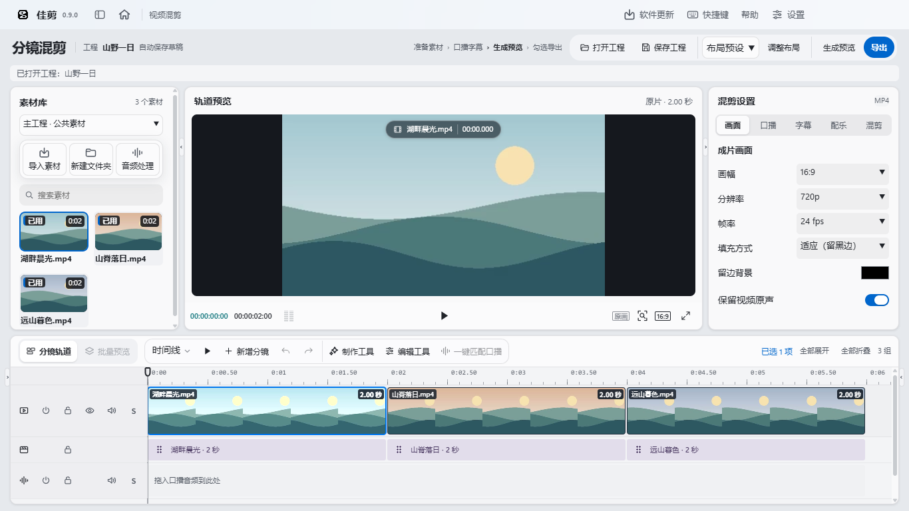

**内部专用，禁止外传**

# 佳剪

佳剪是一款 Windows x64 桌面剪辑软件。把素材按分镜分组，配上口播和字幕，即可预览并批量导出 MP4。

## 安装

运行团队分发的 `Jiajian-Setup-版本号-x64.exe`，从 Windows 开始菜单打开「佳剪」。[升级与回退指南](docs/migration.md)

## 第一次混剪

1. 从首页进入「视频混剪」，把视频或图片拖入素材库，再把素材放到分镜。每个分镜至少放一个画面。
2. 在「口播」添加整段音频或逐镜口播，可同时导入字幕。设置成片画幅和帧率。
3. 点「生成预览」，播放检查后勾选需要的组合，点「导出已选」选择保存目录。

## 文档

[使用手册](docs/manual.md) · [快捷键速查](docs/shortcuts.md) · [配音设置](docs/voice.md) · [常见问题](docs/faq.md) · [开发指南](docs/development.md) · [版本记录](CHANGELOG.md)
